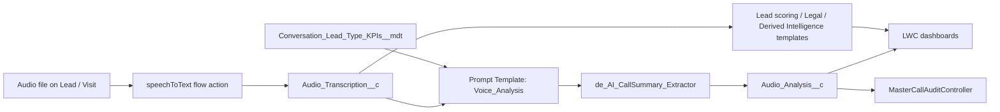

# call-lens

AI call auditing on Salesforce: turn call recordings into transcripts, scored analyses, dashboards and account-level intelligence for Aurelia (a fictional jewellery and FMCG brand).

## What it does

- Plays a call recording attached to a Lead (`de_audioPlayer`) and transcribes it with the Speech Foundation `speechToText` flow action.
- Sends the transcript to Prompt Builder templates (`Voice_Analysis`, `Audio_Analysis_Legal`, `Derived_Intelligence_for_Account`, `Master_Call_Analysis`) and stores the JSON result on `Audio_Analysis__c` / `Audio_Transcription__c`. The KPI questions come from the `Conversation_Lead_Type_KPIs__mdt` records through the `Get_KPI_Questions` flow.
- Renders a per-call analysis dashboard (`de_audioAnalysisDashboard`) and a Visit variant (`de_visit_audio_analysis_dashboard`).
- Scores leads from the call transcript against `Lead_Scoring_Criteria__mdt` (`de_lead_scoring_custom`).
- Builds account-level derived intelligence with `de_derived_intelligence_account`, grounded by the `Ground_Visit_Data_for_Account` flow.
- Analyses legal conversations (`de_legal_audio_analysis`, `de_LegalAudioService`).
- Aggregates audits across many Leads in Apex only, no LLM (`MasterCallAuditController`): date range, lead type (journey), agent, individual call. Agent options are gated by the `Agent_Name_Access` permission set.
- `Call_Audit_V2` Lightning page hosts the lead selector.

## Architecture



## Components

| Component | Purpose |
|---|---|
| `de_audioPlayer` | Audio playback on the record page |
| `de_audioAnalysisDashboard` / `de_AudioAnalysisController` | Lead call analysis dashboard |
| `de_visit_audio_analysis_dashboard` / `_apex` | Same dashboard for Visit records |
| `de_leadSelector_v2` / `de_LeadSelector_v2Controller` | Pick a lead and drive the analysis |
| `de_lead_scoring_custom` / `de_lead_scoring_custom_apex` | Transcript based lead score |
| `de_derived_intelligence_account` / `_apex` | Account derived intelligence |
| `de_legal_audio_analysis` / `de_LegalAudioService` | Upload and analyse legal audio |
| `de_flowNextButton` | Flow screen navigation helper |
| `MasterCallAuditController` | Aggregated master audit |
| `de_AI_CallSummary_Extractor`, `de_Split_String_For_Flow` | Flow invocable actions |
| `de_AudioFileUtilities` | Audio file helpers |
| Flows | `Flow_for_Analyzing_Voice_Calls`, `Audio_Analysis_from_Speech_Foundation_Core_Action`, `Get_KPI_Questions`, `Ground_Visit_Data_for_Account`, `de_Speech_To_Text_Flow` |
| Prompt templates | `Voice_Analysis`, `Audio_Analysis_Legal`, `Derived_Intelligence_for_Account`, `Master_Call_Analysis` |
| Custom metadata | `Conversation_Lead_Type_KPIs__mdt` (X1-X51), `Lead_Scoring_Criteria__mdt` (LS1-LS9) |
| Objects | Custom fields on `Lead` and `Visit` |

## Prerequisites

- Salesforce CLI (`sf`), a scratch or sandbox org
- Einstein Generative AI / Prompt Builder enabled
- Speech Foundation (`speechToText` flow action) available in the org
- The standard `Visit` object (Field Service / Visit support) for the Visit dashboard

## Setup and deploy

```bash
sf project deploy start --source-dir force-app --target-org <alias>
sf org assign permset --name Agent_Name_Access --target-org <alias>
```

Then add the LWCs to Lead / Visit / Account record pages, and open the `Call_Audit_V2` page.

## Configuration

- Custom metadata: review the KPI questions and scoring criteria records for your own business.
- `de_lead_scoring_custom_apex` calls a prompt template named `Lead_Scoring_Prompt`, which is not included in this repo. Create it in Prompt Builder (input: the lead transcript) or change the constant.
- `Lead_Type__c` and `Agent_Name__c` on Lead drive the filters in the master audit.
- `File_URL__c` formulas use a relative download path, so they work in whichever org you deploy to.
- No credentials are stored in this repo.

## Screenshots

Add screenshots to `docs/screenshots/`.

## License

MIT, see [LICENSE](LICENSE).
